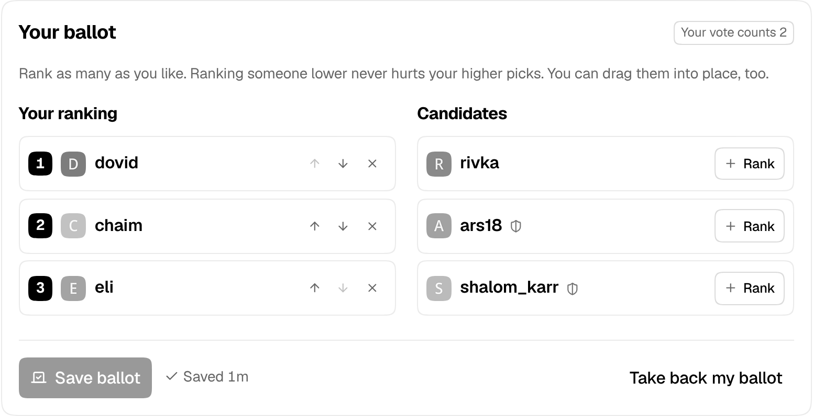

# Mod elections: the forum picks its moderators

Every few months the forum elects its moderators. Anyone in good standing can run, members rank the candidates, and the count is published stage by stage so anyone can follow how each seat was won. Admins stay as they are: they never run and never vote.

## How an election runs

1. **Nominations** open at midnight on the 1st of each scheduled month (January, April, July and October by default) and last a week. The sitting moderators are on the ballot already and can drop out. Everyone else who can run gets a notification saying so, and signs up on `/elections` with a few lines about themselves. There's no limit on how many run: the seats are how many win.
2. **Vote Week** follows, if there's something to vote on (see below). Voters rank as many candidates as they like, best first, and can change or take back their ballot until it ends. Each voter sees the candidates in their own shuffled order, so nobody is always at the top.
3. **The count.** When Vote Week ends, admins get a notification. On the Mod elections tab they check for ballots cast from one address, set aside any that are alt accounts (with a reason the voter sees), preview the count and the moderator changes it makes, then publish. The first preview fixes the ballots: none can be set aside or counted again after it, so nobody can compare two previews to work out what was on one ballot.

Publishing makes the winners moderators and takes moderator rights from the sitting moderators who weren't elected. All the seats are up every time. The preview marks any moderator who was never on this ballot (made a moderator after nominations opened), since publishing ends their seat too. If a winner can't take the seat any more (their account was deleted, suspended or silenced, or they became an admin), publishing waits: the preview says who and why, the admin takes them off the ballot with a reason, and the count gives the seat to the next in line.

Deadlines are exact to the minute: a ballot or a candidacy sent a minute after the phase ended is turned away, even before the page moves on.

**When there's nothing to vote on.** If nominations close with no more candidates than seats, the count would elect every one of them whatever the ballots said, so a vote would change nothing. Nominations stay open three more days instead, once, and members who can run hear about it (a notification and a new banner); Vote Week moves back by the same. If there are more candidates than seats by then, Vote Week runs as usual. If not, there's no Vote Week: nobody is asked to vote, the page says the candidates are elected unopposed, and admins get a notification to check the preview and publish, which seats them. An admin closing nominations early from the tab never gets the extra days.

There's a page at `/elections` for members (trust level 1 and up by default, `mod_elections_view_allowed_groups`; a visitor is sent to log in), linked from the sidebar's *More* list for those who can open it, a banner while nominations are open and for voters who haven't voted yet, and notifications when nominations open (to members who can run), when Vote Week opens and a day before it ends (never on Vote Week's first day). The page moves on by itself when a step changes, shows each step's date as a day on the forum's calendar, counts down to the end of the current one, and says when the next election opens. After voting closes it tells each voter whether their ballot went into the count. On a computer candidates can be dragged into place as well as moved with the buttons; every button names its candidate for screen readers, and each change is read out. Dumbcourse has the same page: on a flip phone, pick a candidate and press 1–9 to put them in that place, or 0 to take them off.

If Disteleplus sends admin notices to Telegram, the staff topic there hears when voting closes (with how many ballots came in) and who won when the results are published.

If a category is set, each election gets a topic there: the schedule when nominations open, the candidates when Vote Week opens, and the winners when the results are published. Candidates are linked, not @mentioned.

## Who can run and who can vote

- **Running:** trust level 2 or higher, an account at least 90 days old, and no suspension or silence from an admin in the last 180 days (a moderator's don't count: sitting moderators are candidates too, and the tab lists any suspension or silence a moderator gives a candidate or a voter during the election). Sitting moderators can always run. Admins can't. A candidate whose trust level drops below what running needs before voting closes is taken off the ballot, with that as the reason; an admin can put them back. An admin can take a candidate off the ballot, but has to give a reason, and it's shown to signed-in members on the page.
- **Voting:** the voter list is fixed when nominations open. It has every account at least 30 days old at trust level 1 or higher that can open the elections page, not suspended, silenced or staged, and not an admin. **A vote counts as much as the voter's trust level** at that moment, so trust level 3 counts 3 and trust level 0 doesn't vote. New accounts and level-ups during the election change nothing. A trust level that drops before voting closes does: the vote drops to the new level, a ballot already cast included, and below trust level 1 (or out of the groups that can open the page) the voter is off the list and their ballot is gone. Accounts suspended or silenced since can't vote. Candidates vote too, just not for themselves.

All of these are settings.

## The count

The count is the single transferable vote, as used for Ireland's elections:

- With 3 seats, a candidate needs just over a quarter of the votes to win (the Droop quota).
- Everyone's first choice is counted. Anyone over the quota is elected, and the votes they didn't need move on to their voters' next choices at a reduced value.
- When nobody is over the quota, whoever has the fewest votes is out and their ballots move to each voter's next choice. Everyone with no votes at all goes out in one step, as long as enough people are left to fill the seats.
- This repeats until every seat is filled.

Ranking someone lower never hurts your higher choices: your next choice only counts once your earlier ones have won or are out. A tie goes to whoever did better at the earliest stage where they differed, and if they were level at every stage, it's drawn by lot. The lot's seed is drawn when voting closes and published with the results, so the preview and the published count always agree, and anyone can check a draw. Every tie is listed under the count: which stage, who was level, what it decided (who went out, whose extra votes moved first, or who is listed first among people elected together) and whether an earlier stage or the lot settled it.

The results show every stage, with a bar under each number for how close it was to the quota, the turnout and the quota. Who ranked whom is never shown to anyone. Ballots are tied to accounts only while the election runs, so nobody votes twice; admins see only who voted from which address, once voting has closed, never a ballot's contents. When the results are published every ballot loses its account and address: each voter can still see whether theirs was counted, but nothing links anyone to a ranking any more. A cancelled election's ballots are deleted. With very few voters, the published stages can still give away how individuals voted.

If no more people run than there are seats, there's no Vote Week (see above): they're elected unopposed, and any seats left over stay empty until admins appoint someone. If nobody voted in a contested election, it can't be published: cancel it and the moderators stay as they are.

A deleted account's ballot stays in the count, so a result can't change after the fact. A candidate whose account is deleted comes off the ballot while nominations or Vote Week are still open, and their voters' ballots move on to the next choice; after voting closes they stay in the count and the preview lists them for the admin.

Running and voting work only from the member's own browser: not with an API key, and not for an admin impersonating them. They're rate limited, so a script can't hammer them.

## Former moderators and strikes

Anyone who wins a seat is locked at trust level 4, and keeps it after leaving the seat, so trust level 4 marks people who were moderators. Trust level 4 can still edit posts and close, move and rename topics, so former moderators keep those powers (`mod_elections_former_mods_keep_tl4` turns this off).

A sitting moderator who runs again and loses gets a strike. At the second strike they go back to trust level 3, unlocked, and the usual trust level 3 rules apply again. Stepping down, not running, and losing while not in a seat give no strike.

## Seats between elections

On the Mod elections tab an admin can mark a moderator as **stepped down** (they keep trust level 4) or **removed for abuse** (back to trust level 3). If they're on the ballot of an election under way, stepping down takes them off it, and removal for abuse takes them off with that as the reason. Either way the seat can be filled by **countback**: the same ballots are counted again without the people who left, and the first newly elected candidate who can still serve takes the seat. No new vote.

## Starting one by hand

The tab can also start an election off the calendar, with its own dates and number of seats (Vote Week has to start in the future, so people have time to run), end a phase early, or cancel an election. An election under way can be changed too (**Change seats or dates**): its number of seats and any date still ahead, until voting closes. Before nominations open that is every date; during nominations, when they close and when Vote Week ends; during Vote Week, when it ends. A new date has to be in the future. Once voting has closed the seats and dates are fixed, since more or fewer seats then would change who the ballots elect. Each change goes in the staff log and, with a category set, in the election's topic. A cancelled election stays cancelled; the schedule won't start it again, even if the time zone setting changes. Only one election runs at a time: if one is still unpublished when the next is due, the next doesn't start, and admins get a notification saying so. While the module is off the tab still shows everything, but changes nothing.

## Settings

Admin → Plugins → Jtech Tools → **Mod elections**. The full text of each setting is shown next to it in the admin.

| Setting | Default | What it does |
| --- | --- | --- |
| `mod_elections_enabled` | `false` | Lets the forum elect its moderators. |
| `mod_elections_seats` | `3` | How many moderators each election picks. |
| `mod_elections_view_allowed_groups` | `trust_level_1` | Groups that can open the elections page; a logged-out visitor is sent to log in. |
| `mod_elections_schedule_months` | `1\|4\|7\|10` | Months an election starts in. |
| `mod_elections_timezone` | `America/New_York` | Time zone the calendar runs in. |
| `mod_elections_nomination_days` | `7` | How long nominations stay open. |
| `mod_elections_nomination_extension_days` | `3` | Extra days of nominations, once, when they close with no more candidates than seats. |
| `mod_elections_voting_days` | `7` | How long Vote Week lasts, starting when nominations close. |
| `mod_elections_candidate_min_trust_level` | `2` | Lowest trust level that can run. |
| `mod_elections_candidate_min_account_age_days` | `90` | How old an account has to be to run. |
| `mod_elections_candidate_clean_record_days` | `180` | Accounts an admin suspended or silenced within this many days can't run. |
| `mod_elections_statement_max_length` | `1000` | Longest statement a candidate can write about themselves. |
| `mod_elections_voter_min_account_age_days` | `30` | How old an account has to be, when nominations open, to vote. |
| `mod_elections_former_mods_keep_tl4` | `true` | Moderators who leave their seat keep trust level 4, locked. |
| `mod_elections_strikes_before_tl3` | `2` | At this many strikes a former moderator goes back to trust level 3. |
| `mod_elections_category` | (blank) | Category for each election's topic. |
| `mod_elections_notify_voters` | `true` | Sends voters a notification when Vote Week opens, and a reminder a day before it ends. |
| `mod_elections_invite_candidates` | `true` | Sends members who can run a notification when nominations open, and again if they stay open longer. |

[← All features](../README.md#features)
